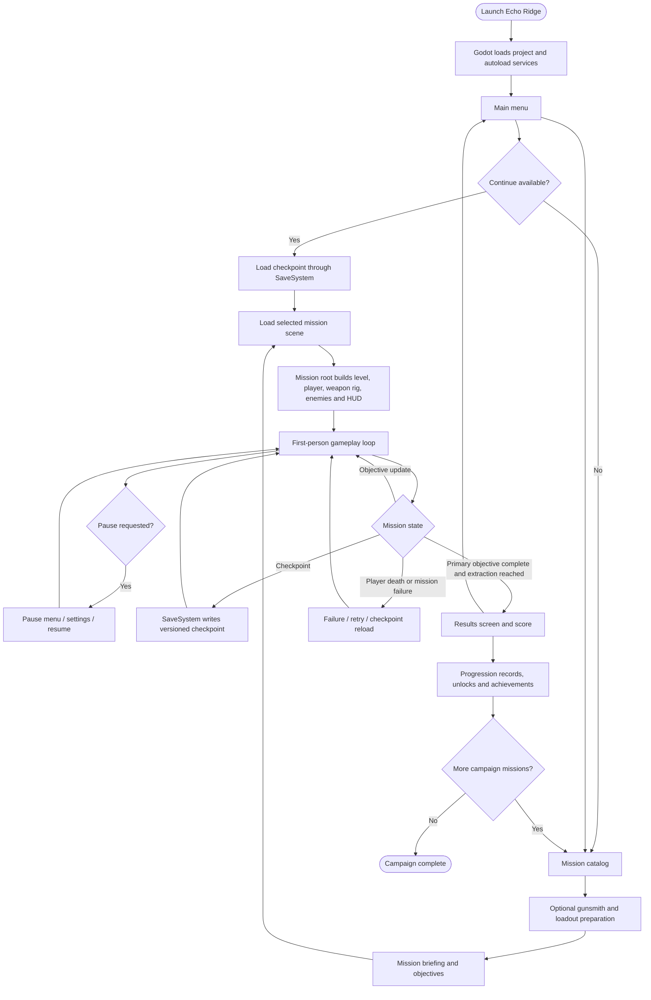
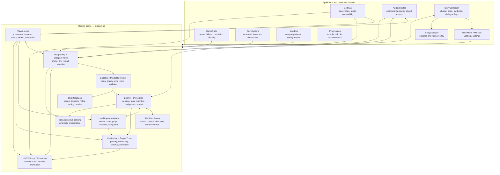
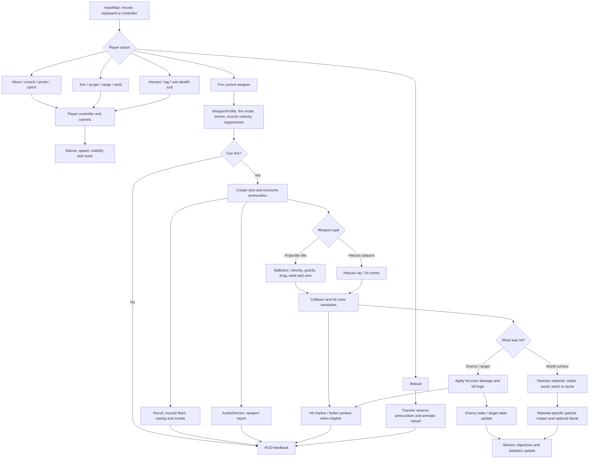
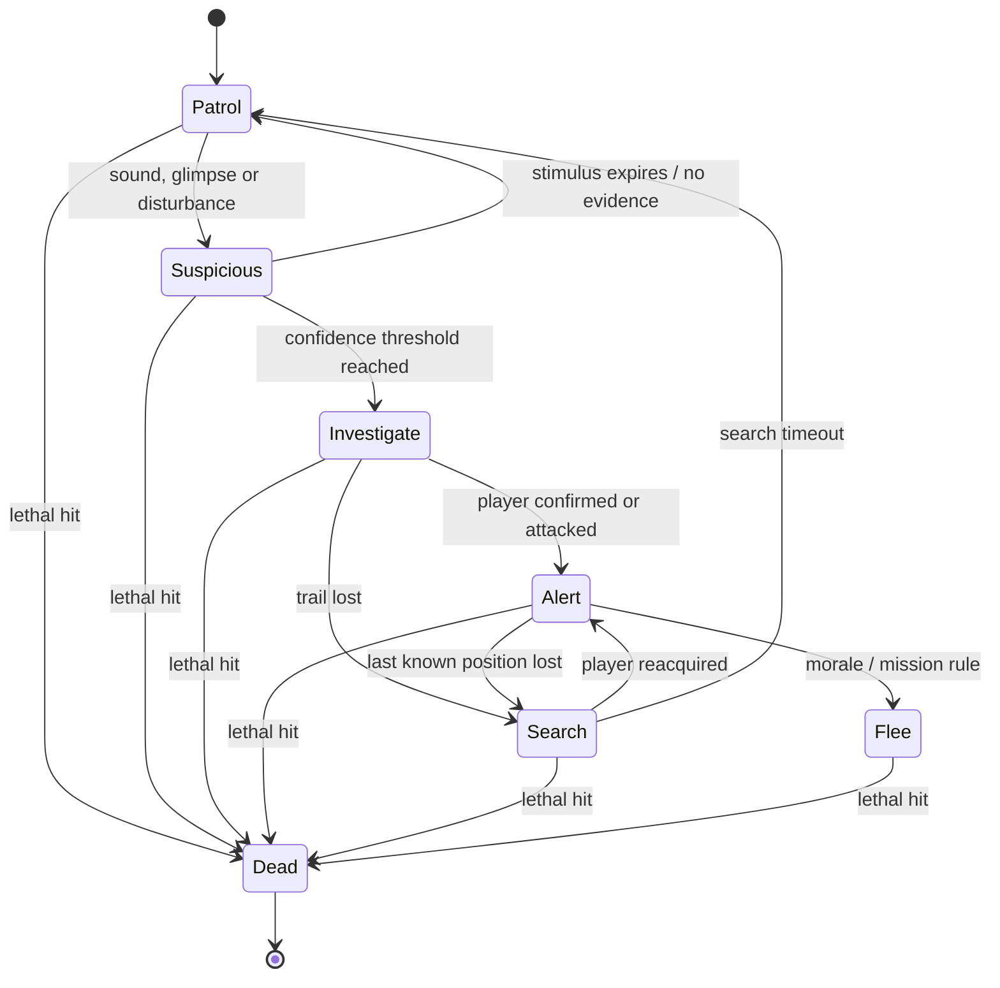
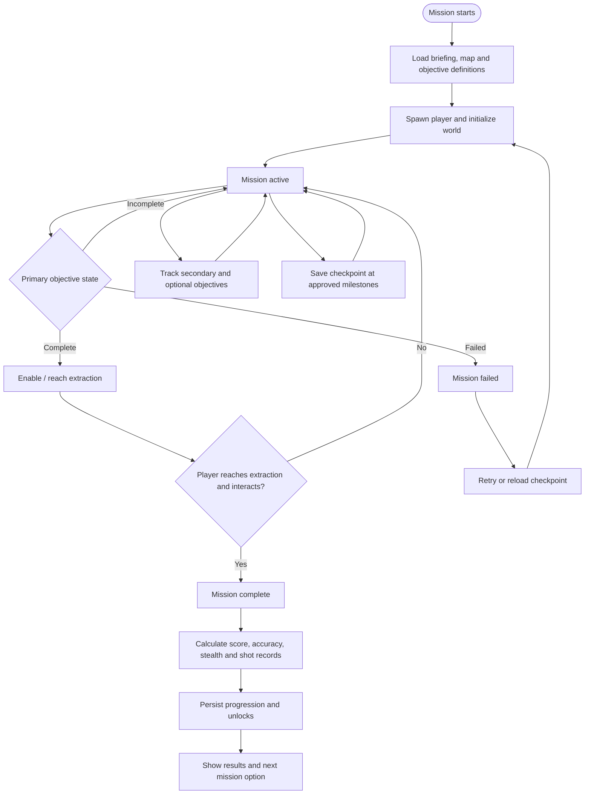
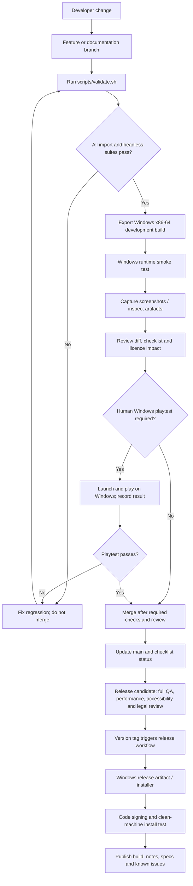
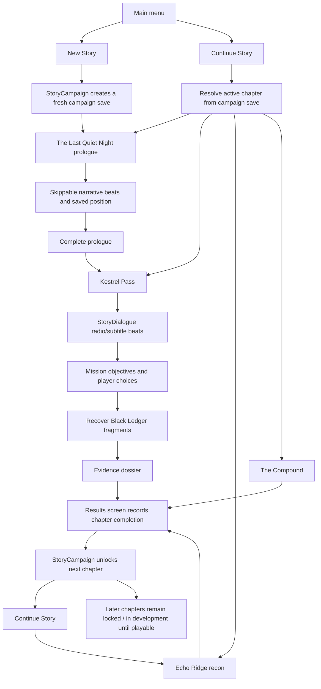

# Echo Ridge — game flow and system architecture

This document is the map of how the game is intended to work from launch to mission completion. The master production tracker is **[CHECKLIST.md](CHECKLIST.md)**; this file explains the systems and the paths between them.

> **Status note (26 November 2026):** The diagrams describe the current architecture and intended finished-game flow. Some systems are already implemented, some are procedural foundations, and some remain roadmap work. A diagram is not proof that a feature is complete. Use the checklist's `[x]` / `[~]` / `[ ]` status and each item's verification requirement as the source of truth.

## 1. Whole-game flow

## 2. Runtime architecture — which system owns what

### Persistent services

| Service | Responsibility |
|---|---|
| `GameState` | Shared mission state: pause, completion/failure, difficulty and mission-level flags |
| `Settings` | Saved user preferences, controls, sensitivity, video/audio and accessibility options |
| `SaveSystem` | Versioned save data, checkpoints, quick save/load and validation of corrupt or incompatible files |
| `Loadout` | Installed weapon parts and per-weapon configurations |
| `Progression` | Mission records, best score/time/shot distance, unlocks and achievements |
| `AudioDirector` | Positional gameplay sound events and SFX preference handling |
| `StoryCampaign` | Saved story chapter, unlocks, evidence, seen dialogue, flags and ending decision |
| `StoryDialogue` | Shared subtitle/radio overlay that presents lines requested by the story campaign |

### Mission scene ownership

The mission root coordinates the active level and game systems. The level owns the physical world and level-specific setup. The player owns movement and first-person interaction. The weapon rig owns the current weapon's firing/reload state. The ballistics system owns projectile travel and hit resolution. Enemies own their individual perception and behaviour; the alert coordinator shares information between them. The mission log owns objective state and completion rules. UI reads and presents state; it should not become the owner of gameplay rules.

## 3. Player and weapon loop — from input to impact

The intended shot chain is: **input → weapon validation → ammunition consumption → projectile or hitscan → collision → hit-zone/material response → mission statistics/objectives → player feedback**. A weapon profile supplies the weapon-specific values; the ballistics system should not contain UI rules.

## 4. Enemy perception and response

Enemy perception combines sight, distance, occlusion, stance/light exposure and hearing. Gunshots, footsteps and distractions are stimuli. Each enemy changes its own state; the alert coordinator shares last-known player information, changes the overall alert level and can trigger reinforcements. Body discovery is another world stimulus. The finished game still needs authored animations, varied characters, convincing hit reactions and ragdoll/death presentation.

## 5. Mission lifecycle and objective rules

Mission content should be data-driven where practical: objective definitions, trigger zones, enemy placements, mission phases and extraction rules belong to the mission/level, not hard-coded into generic UI. Optional objectives should never block primary completion unless explicitly designed to do so.

## 6. Build, test and release pipeline

The automated Windows runtime smoke test is not a substitute for a human playtest. A green CI run does not prove that controls feel good, graphics look finished, sound works on a user's device, performance meets the target, or a full campaign can be completed.

## 7. Where to find the implementation

| Area | Main files |
|---|---|
| Project entry and menu | `project.godot`, `scenes/ui/main_menu.tscn`, `scenes/ui/main_menu.gd` |
| Mission coordinator | `mission.gd`, `main.tscn`, `kestrel_mission.tscn`, `compound_mission.tscn` |
| Player | `scenes/player/player.tscn`, `scenes/player/player.gd`, `scenes/player/stealth_kit.gd` |
| Weapons and scope | `scenes/weapons/`, `ballistics.gd`, `scope_overlay.gd` |
| Enemies | `scenes/enemies/enemy.gd`, `perception.gd`, `alert_coordinator.gd`, `enemy_visual.gd` |
| Levels and atmosphere | `scenes/levels/` |
| Objectives | `scenes/missions/mission_log.gd`, `trigger_zone.gd` |
| Feedback and takedowns | `scenes/fx/shot_feedback.gd`, `scenes/killcam.gd`, `scenes/takedown_controller.gd` |
| UI | `scenes/ui/` |
| Persistent services | `autoload/` |
| Automated tests | `tests/`, run by `scripts/validate.sh` |
| CI and Windows export | `.github/workflows/build.yml`, `projectiles.yml`, `windows-runtime.yml`, `release.yml` |

## 8. How the master checklist is maintained

The authoritative task list is **[CHECKLIST.md](CHECKLIST.md)**.

- `[ ]` = not complete.
- `[~]` = partially implemented or awaiting required verification.
- `[x]` = implemented **and** its stated verification passed.
- Every feature PR must identify the checklist item(s) it changes.
- Update the checklist in the same PR as the implementation.
- Do not mark a Windows visual/audio/playtest item complete based only on headless tests or a successful export.
- Owner-only tasks (accounts, certificates, branch protection, store setup, legal approvals and physical Windows testing) remain open until the owner completes them.
- Each phase has an exit gate. Do not call the game complete until the release exit gate in the master checklist is satisfied.

For validation commands, test coverage and playtest recording, see [VALIDATION.md](VALIDATION.md). For the full production sequence and outstanding work, see [CHECKLIST.md](CHECKLIST.md).

## 9. Story mode flow — prologue to campaign progression

### Story ownership and save boundaries

- `StoryCampaign` owns narrative progress and saves to `user://campaign/story.json`. It is separate from `SaveSystem` mission checkpoints and `Progression` score records.
- `StoryDialogue` is a presentation layer. It receives speaker/line events; it does not decide whether a chapter or evidence item is unlocked.
- Mission objective events can request one-time dialogue and add evidence. Replayed scenes do not repeat already-seen one-time story lines.
- The prologue stores its current beat so Continue Story resumes the sequence.
- The current story path connects the prologue to Kestrel Pass, Echo Ridge recon and The Compound. Later campaign chapters are intentionally not selectable until their playable scenes exist.
- The current prologue is a text-and-dialogue cinematic presentation. A fully playable 3D home/ambush sequence, authored cinematics, voice acting and the final boss/ending presentation remain production work.
